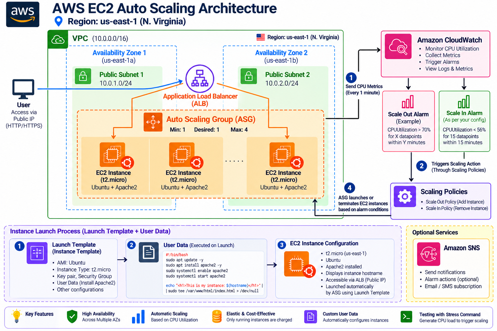

# 🚀 AWS EC2 Auto Scaling with CloudWatch CPU Monitoring

##❯❯❯❯Forward --> Linkdin-Post

**Linkdin-Post:** https://lnkd.in/p/gi8nb-cp  
---

## 🏗️ Architecture



---

### Components

- **Amazon EC2** – Runs the Ubuntu application/server instance.
- **CloudWatch** – Monitors EC2 CPU utilization.
- **CloudWatch Alarms** – Detect high and low CPU conditions.
- **Launch Template** – Defines the configuration for instances created by the Auto Scaling Group.
- **Auto Scaling Group (ASG)** – Automatically adds or removes EC2 instances based on CPU conditions.
- **Target Tracking Scaling** – Maintains the required CPU utilization by adjusting instance capacity.

---

## 🛠️ Implementation Steps
---

## 1️⃣ Launch the EC2 Instance

- Created an **Ubuntu 26.04 LTS EC2 instance**.
- Connected to the instance using SSH with the `.pem` key.
- Verified that the instance was running successfully.

```bash
ssh -i "Expri.pem" ubuntu@<EC2-PUBLIC-DNS>
```

---

## 2️⃣ Install and Run CPU Stress Test

To simulate high CPU utilization, I used the `stress` utility.

```bash
stress --cpu 5 --timeout 600s
```

- Started **5 CPU stress workers**.
- The CPU utilization increased significantly.
- Verified the CPU load using `top`.

```bash
top
```

The EC2 instance reached heavy CPU utilization, allowing the Auto Scaling and CloudWatch configuration to be tested under realistic load. 🔥

---

## 3️⃣ Monitor CPU Utilization

Used the Linux `top` command to verify the actual CPU usage on the EC2 instance.

```bash
top
```

The stress processes consumed most of the available CPU resources, confirming that the test workload was working correctly.

---

## 4️⃣ Configure CloudWatch Monitoring

Used **Amazon CloudWatch** to monitor the EC2 `CPUUtilization` metric.

📊 CloudWatch was configured to continuously evaluate CPU utilization and trigger scaling actions when the configured thresholds were reached.

---

## 5️⃣ Create High CPU Alarm

Created a CloudWatch alarm for high CPU utilization.

### 🔴 Scale-Out Condition

```text
CPUUtilization > 80%
for 3 datapoints within 3 minutes
```

When CPU utilization remained above the threshold, the alarm entered the **ALARM** state and triggered the Auto Scaling action.

---

## 6️⃣ Create Low CPU Alarm

Created another CloudWatch alarm for reduced CPU utilization.

### 🟢 Scale-In Condition

```text
CPUUtilization < 56%
for 15 datapoints within 15 minutes
```

This alarm allows the Auto Scaling Group to reduce capacity when the workload decreases.

---

## 7️⃣ Configure Auto Scaling Group

Created the Auto Scaling Group:

```text
Demo-Auto-Scaling-Gp
```

Configured the capacity:

```yaml
Minimum capacity : 1
Desired capacity : 1
Maximum capacity  : 4
```

The Auto Scaling Group was configured to maintain the required number of healthy EC2 instances automatically.

---

## 8️⃣ Configure Target Tracking

Configured **target tracking scaling** based on CPU utilization.

The Auto Scaling Group continuously evaluates the CPU metric and automatically adjusts the number of EC2 instances according to the workload.

---

## 9️⃣ Trigger Scale-Out

Started the CPU stress test on the EC2 instance.

🔥 CPU utilization increased above the configured threshold.

CloudWatch detected the high CPU usage and changed the high-CPU alarm to **ALARM**.

The Auto Scaling Group then responded by launching an additional EC2 instance.

---

## 🔟 Verify New EC2 Instance

Verified the EC2 console after the scaling action.

The Auto Scaling Group successfully created a new instance in another Availability Zone:

```text
us-east-1c
```

This demonstrated that the workload could automatically scale out when CPU utilization increased.

---

## 1️⃣1️⃣ Stop the CPU Stress Test

Stopped the CPU stress workload after verifying the scale-out behavior.

As the workload stopped:

```text
CPU Utilization ↓
```

CloudWatch continued monitoring the instance and detected that CPU utilization was falling.

---

## 1️⃣2️⃣ Verify Scale-In Behavior

After CPU utilization decreased, the Auto Scaling Group detected the reduced workload through the target-tracking configuration.

The low-CPU alarm moved into the appropriate state, allowing the Auto Scaling Group to reduce the required capacity.

This demonstrated both:

```text
🔥 High CPU → Scale Out
❄️ Low CPU  → Scale In
```

---

## 1️⃣3️⃣ Verify Auto Scaling Events

Checked the EC2 console and CloudWatch alarms to confirm the scaling behavior.

The monitoring flow successfully demonstrated:

```text
CPU Load
   ↓
CloudWatch Metric
   ↓
CloudWatch Alarm
   ↓
Auto Scaling Action
   ↓
EC2 Capacity Changes
```

---

## 1️⃣4️⃣ Clean Up AWS Resources 🧹

After completing the Auto Scaling demonstration, I cleaned up the resources to avoid unnecessary AWS charges.

- Removed the Auto Scaling Group.
- Allowed the associated resources/instances to be removed.
- Terminated the EC2 instance created for the demonstration.
- Verified that the Auto Scaling Group was deleted.

---

# 🔄 Complete Implementation Flow

```text
🖥️ EC2 Instance
      ↓
🔥 Generate CPU Load
      ↓
📊 CloudWatch Monitors CPUUtilization
      ↓
🚨 CPU > 80%
      ↓
⚡ CloudWatch Alarm
      ↓
📈 Auto Scaling Group
      ↓
➕ Launch New EC2 Instance
      ↓
⏹️ Stop CPU Stress
      ↓
📉 CPU Utilization Decreases
      ↓
📊 CloudWatch Detects Lower Load
      ↓
📉 Target Tracking
      ↓
➖ Reduce EC2 Capacity
```

# 🎯 Implementation Result

Successfully implemented and tested an **AWS EC2 Auto Scaling environment with Amazon CloudWatch monitoring**, including:

- 🖥️ EC2 instance deployment
- 🔥 CPU stress testing
- 📊 CloudWatch CPU monitoring
- 🚨 High CPU alarm configuration
- 📉 Low CPU alarm configuration
- ⚡ Auto Scaling Group configuration
- 🎯 Target tracking scaling
- ➕ Automatic scale-out
- ➖ Automatic scale-in
- 🌎 Multi-AZ instance creation
- 🧹 AWS resource cleanup

This project demonstrated how AWS can automatically adjust compute capacity based on application workload and CPU utilization.


---

## 👨‍💻 Author

**Tanveer Rabbani**  
B.Tech – Information Technology  
Cloud & DevOps Enthusiast

**GitHub:** https://github.com/tanveerrabbani5  
**LinkedIn:** https://www.linkedin.com/in/tanveer-rabbani-a-870729362/

